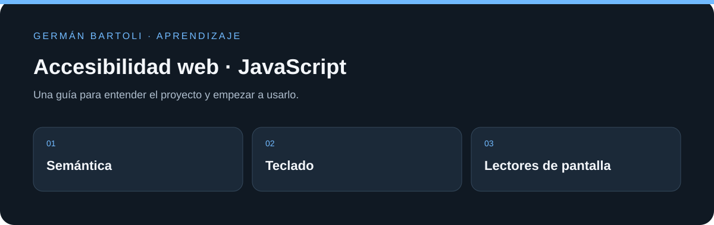

# Accesibilidad web · JavaScript

**Ejercicios de navegación, semántica y accesibilidad en interfaces HTML y JavaScript.**

[Empezar](#primeros-pasos) · [Mapa del repositorio](#mapa-del-repositorio) · [Autoría](#autoría-de-esta-documentación)

*Esquema de orientación; no representa una captura de la aplicación.*

## Primeros pasos

1. Abrí las páginas HTML y compará `index.js` con `final.js`.
2. Recorré la interfaz con Tab, Shift+Tab y Enter, comprobando el foco visible y el orden de navegación.
3. Contrastá etiquetas, roles y estados con las herramientas de accesibilidad del navegador y un lector de pantalla.

## Entorno de aprendizaje

Este repositorio conserva ejercicios y versiones de su etapa de estudio. Revisá los archivos de proyecto para preparar el SDK, runtime o servidor correspondiente; esta actualización del README no migra dependencias ni acredita una ejecución reciente de todos los ejemplos.

## Referencia y detalles

https://platzi.com/cursos/accesibilidad-web/

https://github.com/gmzjuliana/curso-acessibilidad-web

53 Browser Extensions to Perform Accessibility Testing
https://www.digitala11y.com/accessibility-plug-ins-ie-chrome-firefox-browsers/

Clase 11
Pruebas manuales con lectores de pantalla
https://webaim.org/ , ver accesibilidad de la página, f12 -> elementos -> accesibilidad

Clase 12
Voice Over, HTML Semántico y no Semántico

ARIA: Accessible Rich Internet Applications

Roles, propiedades, estados

WCAG: Web Content Accessibility Guidelines

https://developers.google.com/web/fundamentals/accessibility/semantics-aria/aria-labels-and-relationships

## Mapa del repositorio

- [index.html](<index.html>)
- [docs/PUBLICACION.md](<docs/PUBLICACION.md>)

## Autoría de esta documentación

Repositorio mantenido por [Germán Bartoli](https://github.com/GermanBartoli). Guía revisada y actualizada con **Codex**, coautor de esta actualización documental. Los autores, colaboradores, licencias y recursos de terceros conservan sus créditos originales.

Los commits de esta revisión incluyen `Co-authored-by: Codex <noreply@openai.com>`; esta atribución no modifica la autoría del historial anterior.
